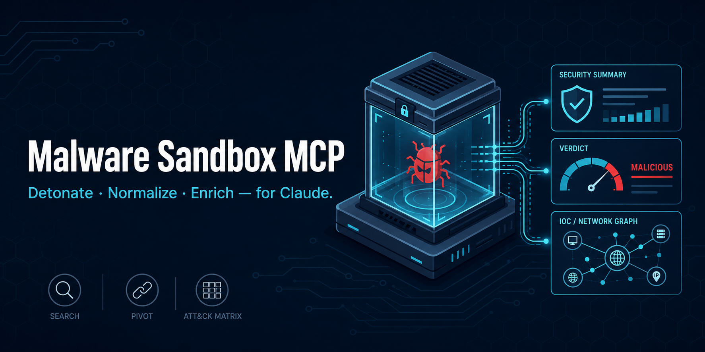

# malware-sandbox-mcp



[](https://github.com/mukul975/Malware-Sandbox-mcp/actions/workflows/ci.yml)
[](LICENSE)
[](pyproject.toml)
[](https://modelcontextprotocol.io)
[](https://github.com/astral-sh/ruff)
[](https://github.com/mukul975/Malware-Sandbox-mcp/stargazers)

**Detonate suspicious files and URLs in cloud malware sandboxes — and pull back normalized verdicts, IOCs and MITRE ATT&CK techniques — directly from Claude.**

> [!WARNING]
> **For authorized security research and defensive use only.** This server submits files and URLs to **third-party cloud sandboxes**; on free/community tiers (tria.ge, abuse.ch, Hybrid Analysis) submissions and results may be **public and non-deletable**. Do not submit confidential, personal, or proprietary data. This repository contains **no live malware samples**. You are responsible for complying with each provider's Terms of Service and your local laws. See [Safety, legal & responsible use](#safety-legal--responsible-use).

## The problem

Triaging one suspicious sample means juggling four browser tabs: submit to a sandbox, wait, copy the verdict, pivot the C2 into a threat-intel database, look the hash up on VirusTotal, then hand-map behaviours to ATT&CK. Every report has a different schema, and the raw JSON is hundreds of kilobytes — far too large to paste into an LLM.

## The solution

One MCP server that wraps **9 backends** behind **20 tools** with a single normalized report schema. Claude submits a sample, polls asynchronously, and gets back a compact (~4K token) report: verdict, threat score, malware family, top signatures, extracted IOCs, and ATT&CK techniques enriched with tactic names and links — plus tools to retrieve artifacts (dropped files, PCAP, screenshots), enrich IOCs across six intel sources, pivot to related samples, compare verdicts across sandboxes, and export an ATT&CK Navigator layer.

Detonation takes 2–10 minutes, but Claude Desktop enforces a hardcoded ~60s MCP tool timeout. This server therefore uses an **async submit → poll** pattern: `submit_sample` returns a `task_id` in seconds, and each `get_report(task_id)` call performs exactly one status poll — no tool call ever blocks waiting for the sandbox.

## Why this tool

- **9 backends, 20 tools** — detonation, artifacts, enrichment, pivoting, comparison, ATT&CK export.
- **Strictly BYOK** — every backend uses *your own* API key from an environment variable; a missing key disables only that backend, and the server still starts.
- **Async, timeout-safe** — submit → poll (handleId) keeps every call under the MCP timeout ceiling.
- **Normalized + token-budgeted** — one schema across vendors, summarized to fit an LLM context.
- **MITRE ATT&CK enrichment** — techniques resolved to tactic names, links, and Navigator layers.
- **Safe by design** — binary artifacts (live malware, PCAPs, dumps) are saved to disk, never inlined; downloads require explicit acknowledgement; all sandbox strings are treated as untrusted data.

## Architecture

```
  Claude  ──submit_sample──▶  malware-sandbox-mcp  ──▶  Detonation sandboxes
    │                              │                     Hybrid Analysis · tria.ge · ANY.RUN
    │   ◀──── task_id ────────     │
    │                              │  normalize ──▶ MITRE ATT&CK enrich ──▶ summarize (<4K tok)
    │   ──get_report(task_id)──▶   │
    │                              ├──▶  Intel sources (enrich / pivot / C2)
    │   ◀── working | report ──    │     MalwareBazaar · ThreatFox · URLhaus · Feodo · URLScan · VirusTotal
    │                              │
    │   ◀── artifacts saved to disk (PCAP, dropped files, screenshots, memory strings)
```

## Tools

All tools degrade gracefully: if the backend they need has no API key, they return a clear "not configured" message instead of failing.

### Detonation & reports
| Tool | Description |
|---|---|
| `submit_sample` | Submit a file or URL to a detonation sandbox (Hybrid Analysis / tria.ge / ANY.RUN). Returns a `task_id` immediately. |
| `get_report` | One async poll of a submission; returns `working` or the final normalized + ATT&CK-enriched report. |
| `get_analysis_state` | Lightweight status poll (and raw lifecycle detail) for a submission. |
| `get_quota` | API quota / usage limits for one backend. |

### Hash & sample intelligence
| Tool | Description |
|---|---|
| `search_hash` | Fast static lookup of an MD5/SHA1/SHA256 across MalwareBazaar, Hybrid Analysis, tria.ge. |
| `bulk_hash_lookup` | Look up many hashes at once for IOC sweeps. |
| `compare_verdicts` | Look up one hash across sandboxes + VirusTotal and diff verdicts, scores and families. |
| `download_sample` | Fetch the raw sample (live malware — requires explicit acknowledgement; saved to disk). |

### Detonation artifacts
| Tool | Description |
|---|---|
| `get_dropped_files` | Retrieve dropped/extracted binaries from a finished analysis. |
| `get_pcap` | Download the network capture (PCAP) for an analysis. |
| `get_screenshots` | Pull execution screenshots for visual triage. |
| `get_memory_strings` | Extracted strings from process memory dumps (Hybrid Analysis). |
| `export_iocs` | Export a report's IOCs as STIX / MISP / OpenIOC / CSV. |
| `export_attack_layer` | Produce a MITRE ATT&CK Navigator layer JSON from the report's techniques. |

### IOC enrichment & pivoting
| Tool | Description |
|---|---|
| `enrich_ioc` | Enrich an IP / domain / URL / hash across ThreatFox, URLhaus, VirusTotal, Feodo. |
| `check_c2_blocklist` | Check whether an IP/domain is a known botnet C2 (Feodo + ThreatFox + URLhaus). |
| `search_samples` | Search by family / tag / signature / IOC across sandboxes + ThreatFox. |
| `pivot_ioc` | Given an IOC, find all related samples across HA, tria.ge, MalwareBazaar, ThreatFox. |

### URL analysis
| Tool | Description |
|---|---|
| `scan_url` | Submit a URL to URLScan.io (unlisted by default; public requires acknowledgement). |
| `get_url_scan_result` | Retrieve a URLScan result (verdict, screenshot URL, contacted infrastructure). |

## Installation

Requires **Python 3.11+** and [**uv**](https://docs.astral.sh/uv/).

```bash
git clone https://github.com/mukul975/Malware-Sandbox-mcp.git
cd Malware-Sandbox-mcp
uv sync            # create the venv and install dependencies
uv run python server.py    # run over stdio (Ctrl-C to stop)
```

Pip fallback:

```bash
python -m venv .venv && . .venv/Scripts/activate   # Windows; use .venv/bin/activate elsewhere
pip install -e .
python server.py
```

## Configuration (BYOK — bring your own keys)

Every backend reads **your own** API key from an environment variable. Set only the ones you have — anything unset is disabled, and the server still starts. Copy [`.env.example`](.env.example) and fill in what you have, or set the keys directly in your MCP client config below.

| Backend | Env var | Free tier? | Where to get the key |
|---|---|---|---|
| **Hybrid Analysis** (Falcon Sandbox) | `HA_API_KEY` | Yes — but a one-time **vetting** is required to upgrade a restricted (search-only) key to full submit/download. | [hybrid-analysis.com](https://hybrid-analysis.com) → profile → API key |
| **tria.ge** (Recorded Future Sandbox) | `TRIAGE_API_KEY` | Yes — public tier; **submissions are public and cannot be deleted**. | [tria.ge](https://tria.ge) → Account → API access |
| **ANY.RUN** | `ANYRUN_API_KEY` | **No** — API needs a paid Hunter/Enterprise plan (or trial). | [app.any.run](https://app.any.run/plans) → API and Limits |
| **MalwareBazaar** (abuse.ch) | `MALWAREBAZAAR_API_KEY` or `ABUSECH_API_KEY` | Yes — fair use; downloads capped at 2,000/IP/day. | [auth.abuse.ch](https://auth.abuse.ch/) |
| **ThreatFox** (abuse.ch) | `THREATFOX_API_KEY` or `ABUSECH_API_KEY` | Yes — fair use; IOCs older than 6 months are expired. | [auth.abuse.ch](https://auth.abuse.ch/) |
| **URLhaus** (abuse.ch) | `URLHAUS_API_KEY` or `ABUSECH_API_KEY` | Yes — fair use. | [auth.abuse.ch](https://auth.abuse.ch/) |
| **Feodo Tracker** (abuse.ch) | *(none)* | Yes — public blocklist, no key. | n/a |
| **URLScan.io** | `URLSCAN_API_KEY` | Yes — rate-limited per minute/hour/day. | [urlscan.io](https://urlscan.io) → Settings → API |
| **VirusTotal** | `VT_API_KEY` or `VIRUSTOTAL_API_KEY` | Yes — public API: **4 req/min, 500/day, non-commercial only**. | [virustotal.com](https://www.virustotal.com) → API key |

abuse.ch now issues **one Auth-Key for all its services** — set `ABUSECH_API_KEY` once and MalwareBazaar, ThreatFox and URLhaus all use it (the per-service vars override it if needed).

Optional: `SANDBOX_ARTIFACTS_DIR` sets where downloaded samples, PCAPs and screenshots are written (default `data/artifacts/`). `TRIAGE_BASE_URL` points tria.ge at a private cloud.

### Claude Desktop / Claude Code config

Copy [`.mcp.json.example`](.mcp.json.example) to `.mcp.json` (Claude Code, project-local), or paste the block into `claude_desktop_config.json` (Claude Desktop — `%APPDATA%\Claude\claude_desktop_config.json` on Windows):

```json
{
  "mcpServers": {
    "malware-sandbox": {
      "command": "uv",
      "args": ["run", "--directory", "D:\\Malware-Sandbox-mcp", "python", "server.py"],
      "timeout": 600000,
      "env": {
        "HA_API_KEY": "",
        "TRIAGE_API_KEY": "",
        "ABUSECH_API_KEY": "",
        "URLSCAN_API_KEY": "",
        "VT_API_KEY": ""
      }
    }
  }
}
```

On Windows, if your client can't find `uv` on the PATH, wrap it with `cmd /c`:

```json
"command": "cmd",
"args": ["/c", "uv", "run", "--directory", "D:\\Malware-Sandbox-mcp", "python", "server.py"]
```

`timeout` (Claude Code only) keeps long polling sessions and the one-time MITRE ATT&CK dataset download from being cut off. If reports get truncated, raise `MAX_MCP_OUTPUT_TOKENS=50000` in the environment Claude Code runs in.

## Usage examples

Natural-language prompts once the server is connected:

- "Submit `http://example.com` to tria.ge and give me the verdict when it's done."
- "Look up hash `ed01ebfbc9eb5bbea545af4d01bf5f1071661840480439c6e5babe8e080e41aa` everywhere and compare the verdicts."
- "Is `8.8.8.8` a known botnet C2?"
- "Enrich the domain `example.com` across all threat-intel sources."
- "Find related samples for the AgentTesla family."
- "Export an ATT&CK Navigator layer for task `triage:240611-abc123`."

See [`TEST_QUERIES.md`](TEST_QUERIES.md) for ready-to-paste arguments covering every tool.

## Safety, legal & responsible use

- **Authorized & defensive use only.** This is a triage tool for security researchers and SOC/DFIR analysts.
- **Third-party submission.** Files and URLs are sent to external cloud sandboxes. On free/community tiers (tria.ge public, abuse.ch community, Hybrid Analysis public) the submission and its results may be **public and non-deletable**. `submit_sample` and public `scan_url` require an explicit acknowledgement flag. Never submit confidential, personal, or proprietary data.
- **No live malware in this repository.** All tests use mocked HTTP responses (respx); no sample ever leaves a test runner.
- **Live malware handling.** `download_sample` retrieves real malware to disk (MalwareBazaar returns a zip with password `infected`). It requires `acknowledge_malware_download=true`, saves to a quarantine directory, and never executes anything. Handle downloaded artifacts only in an isolated environment.
- **Untrusted content.** Every string in a sandbox report is attacker-controlled and may contain prompt-injection text; the server passes it through strictly as data.
- **Provider Terms of Service.** You must comply with each backend's ToS (e.g. Hybrid Analysis vetting/terms, abuse.ch confirmed-malware-only policy, VirusTotal's non-commercial public-API clause). Results are licensed by their providers; keep usage strictly BYOK.
- **No warranty.** Provided "as is" (see [LICENSE](LICENSE)); the authors are not liable for misuse.

To report a security issue, see [SECURITY.md](SECURITY.md).

## Development

```bash
uv sync --extra dev
uv run pytest            # 156 tests, fully offline (respx-mocked)
uv run ruff check .      # lint
uv run ruff format .     # format
```

Tests never make real network calls — all sandbox/intel HTTP is intercepted by `respx`. See [CONTRIBUTING.md](CONTRIBUTING.md).

## Contributing & policies

- [CONTRIBUTING.md](CONTRIBUTING.md) — dev setup, tests, style, PR expectations
- [SECURITY.md](SECURITY.md) — responsible disclosure + malware-handling policy
- [CHANGELOG.md](CHANGELOG.md) — release history (Keep a Changelog)
- [CODE_OF_CONDUCT.md](CODE_OF_CONDUCT.md) — Contributor Covenant

## License

[MIT](LICENSE) © Mahipal

Threat-intelligence and sandbox data are provided by Hybrid Analysis, Recorded Future (tria.ge), ANY.RUN, abuse.ch (MalwareBazaar / ThreatFox / URLhaus / Feodo Tracker), URLScan.io and VirusTotal under their respective terms. MITRE ATT&CK® is a registered trademark of The MITRE Corporation.
